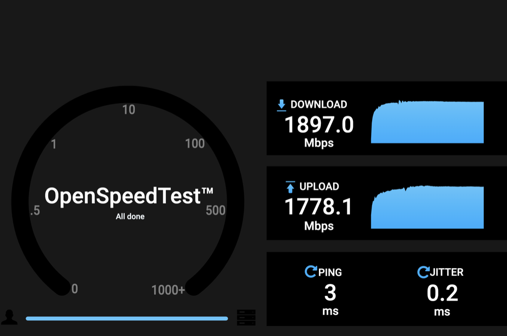
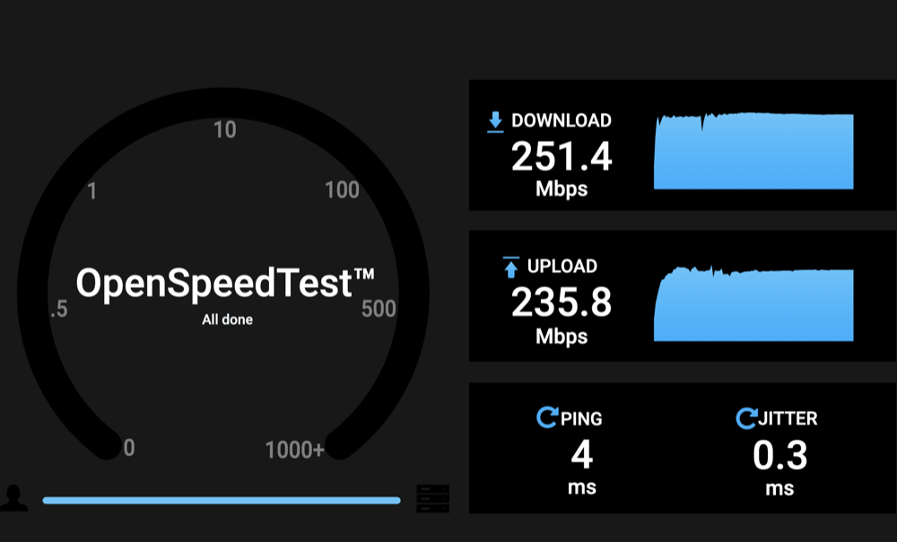

# OpenWrt on Xiaomi BE5000 (Airoha AN7563)

**English** · [Русский](README.ru.md)

> [!IMPORTANT]
> **TL;DR.** This repository shows how to install OpenWrt on the Xiaomi BE5000 with only root SSH access, and how to recover the router over UART if the bootloader is broken.
> - **Three steps:** one command on the computer, one file upload in the browser, Wi-Fi setup. The installer checks the flash chip first: the bootloader here knows 57 NAND chips, including the **Winbond W25N01KV** that the xinyooo and X-WRT bootloaders crash on (`PANIC at PC : 0x810017a9`).
> - **Wi-Fi speed:** 1897 Mbit/s download and 1778 Mbit/s upload through the BE5000 (OpenSpeedTest, a 2x2 160 MHz MacBook to a wired PC).
> - **Two images:** a plain one and one with VPN (AmneziaWG 3.1, Xray from the Amnezia fork, zapret, DNS over HTTPS, policy routing, all with LuCI). With the NPU turned off, through a VPN on the router itself: AmneziaWG 251 Mbit/s download and 236 Mbit/s upload, Xray (VLESS + Reality + xhttp) 104 and 116 Mbit/s.
> - **Tested on hardware:** BE5000 (AN7563PT, W25N01KV, 512 MB DDR3): SSH install from Xiaomi stock firmware, UART recovery, web failsafe install, cold boot, our own OpenWrt build with settings in UBI, Wi-Fi calibration built from the router's own Factory data.

## Contents

1. [What works](#1-what-works)
2. [Requirements](#2-requirements)
3. [Install](#3-install) → details: [docs/en/install-ssh.md](docs/en/install-ssh.md)
4. [If the bootloader is broken: UART](#4-if-the-bootloader-is-broken-uart) → details: [docs/en/recovery-uart.md](docs/en/recovery-uart.md)
5. [Files](#5-files)
6. [How it works](#6-how-it-works) → details: [docs/en/technical.md](docs/en/technical.md)
7. [Sources and credits](#7-sources-and-credits)
8. [Feedback](#8-feedback)

## 1. What works

Everything below is tested on a BE5000 running this firmware.

| What | How it works |
|---|---|
| **System** | OpenWrt SNAPSHOT `r36539+1058`, **Linux 6.18.55** kernel ([build details](firmware/openwrt/README.md)) |
| **5 GHz Wi-Fi** | 3x3, 160 MHz, Wi-Fi 6/7. A 2x2 MacBook (2 streams, 2402 Mbit/s link): **1897 Mbit/s** download, **1778 Mbit/s** upload ([test](docs/en/technical.md#speed)) |
| **Wi-Fi 7** | WPA3 with GCMP-256 and MLO (2.4 + 5 GHz) also go through the NPU: a Wi-Fi 7 client on WPA3 uploads 1560–1760 Mbit/s |
| **2.4 GHz Wi-Fi** | 2x2, works, 20/40 MHz |
| **Hardware offload** | Wi-Fi ↔ wired traffic goes through the PPE and the NPU; the CPU is ~10% busy at full speed. The NPU can be turned off in LuCI when a fast VPN matters more ([details](#npu-offload-and-vpn)) |
| **VPN** (VPN image) | AmneziaWG 3.1, Xray from the Amnezia fork (VLESS, Reality, xhttp), zapret, https-dns-proxy, pbr; all with LuCI ([details](#two-images)) |
| **Roaming** | 802.11r: phones and laptops move seamlessly between the BE5000 and another OpenWrt AP with the same network |
| **Ports** | three 1 Gbit/s ports and one 2.5 Gbit/s port, all in one network |
| **Settings** | survive reboots and power cuts, and are kept across firmware upgrades; about 79 MiB free in `/overlay` for settings and packages |
| **Temperature** | SoC sensors in `/sys/class/thermal` (63–69 °C); the CPU is throttled at 105 °C |
| **Reboot** | warm and cold reboots without hangs; if the system hangs, the watchdog reboots it after ~30 s. Except the reboot right after `sysupgrade` ([known issues](#known-issues)) |
| **Management** | LuCI web UI and SSH at `192.168.1.1`, upgrades with `sysupgrade`. LuCI in English, Russian, Ukrainian, Chinese, German, Spanish, French and Brazilian Portuguese: picked by the browser or in **System → System → Language and Style**. Each radio's dialog offers only its own band (iwinfo fix for the MT7992, whose two radios are one device) |
| **Packages** | `apk add` from the OpenWrt feeds; kernel modules (`kmod-*`, all 1100 of them) and the packages of the VPN image from [this build's own feed](https://pabragin.github.io/xiaomi-be5000-openwrt/) |
| **MAC addresses** | from the router's label, taken from its factory calibration |

**Limitation:** download to a single fast client tops out at about 1.9 Gbit/s. The limit is the PCIe link between the CPU and the radio (one lane, 5 GT/s).

### Two images

Every release has two images. Both install the same way, and `sysupgrade` moves between them with the settings kept.

| Release file | What is inside |
|---|---|
| `openwrt-airoha-an7563-xiaomi_be5000-squashfs-sysupgrade.bin` | plain: Wi-Fi, NPU offload, LuCI |
| `openwrt-airoha-an7563-xiaomi_be5000-full-squashfs-sysupgrade.bin` | VPN: the same plus AmneziaWG 3.1, Xray from the Amnezia fork, zapret, https-dns-proxy (DNS over HTTPS) and pbr (policy routing), all with LuCI |

- **Everything is off in the VPN image.** The packages are installed, but no service runs until it is set up and enabled in LuCI. DNS over HTTPS is off too, because once enabled it takes over the DNS of the whole network.
- **On the plain image** the same packages install with `apk add` from [this build's feed](https://pabragin.github.io/xiaomi-be5000-openwrt/).
- **Also in the feed, with `apk add` only:** `luci-app-podkop` (with `luci-i18n-podkop-ru`; pulls in sing-box), `luci-app-nikki` (mihomo), `youtubeUnblock` + `luci-app-youtubeUnblock`, `byedpi`. They are not in the images: sing-box and mihomo take 10–19 MB each. They install into `/overlay` (~79 MB). As anywhere on OpenWrt, `sysupgrade` keeps the settings but not added packages: install them again after an upgrade and they pick up their settings. The VPN image has them built in.

### NPU offload and VPN

The switch is in LuCI: **Network → NPU acceleration**. The NPU is on by default. A change restarts Wi-Fi for a few seconds.

| What | NPU on | NPU off |
|---|---|---|
| Wi-Fi ↔ wired network | up to ~1.9 Gbit/s | ~1.1 Gbit/s |
| Traffic of the router itself over Wi-Fi (VPN, zapret, services) | ~150 Mbit/s | up to ~900 Mbit/s |
| AmneziaWG on the router | 18–175 / 11–22 Mbit/s | 251 / 236 Mbit/s |
| Xray on the router (VLESS + Reality + xhttp) | ~90 / ~130 Mbit/s | 104 / 116 Mbit/s |

| NPU on: Wi-Fi ↔ wired | NPU off: through AmneziaWG on the router | NPU off: through Xray on the router |
|---|---|---|
|  |  |  |

All: OpenSpeedTest from a 2x2 160 MHz MacBook to a wired PC. In the middle the MacBook goes through an AmneziaWG tunnel to a server on the BE5000 itself, on the right through Xray (VLESS + Reality + xhttp) to a server on the BE5000.

- **When to turn the NPU off:** when Wi-Fi clients reach the internet through a VPN on this router. If the router only forwards traffic, keep it on.
- **Why the NPU is slow here:** frames addressed to the router itself are copied by the NPU into Linux memory through uncached memory, about 48 thousand cycles per frame. That caps them at ~150 Mbit/s. Without the NPU the plain mt76 driver receives them.
- **The limit without the NPU** is the CPU: two Cortex-A53 cores in AArch32 mode without NEON, so encryption runs as scalar code only. AmneziaWG keeps the CPU fully busy.
- **Xray is slower than AmneziaWG:** it encrypts in user space with Go code, AmneziaWG does it in the kernel. The CPU has no AES instructions, and AES-GCM in Go would give about 35–45 Mbit/s. So the Xray in the image offers ChaCha20-Poly1305 first on CPUs without AES instructions, as Chrome does on such CPUs. It works the same way when the BE5000 is the client of a remote Reality server: ~125–135 Mbit/s download.

### Known issues

- **The reboot after `sysupgrade`** sometimes hangs: about 1 in 3 with this build. The LED stays off and the router does not reboot by itself. Unplug the power and plug it back in: the image and the settings are already written (checked in the netconsole log). Plain reboots, warm or cold, do not hang. The hang happens after the software reset of the CPU, before the watchdog runs. The cause is still being looked for.

## 2. Requirements

- **A router with root SSH access** on the Xiaomi stock firmware. Getting root on the stock firmware is not covered here: use [xmir-patcher](https://github.com/openwrt-xiaomi/xmir-patcher), which knows the BE5000 (Russian-language help: the [4PDA thread](https://4pda.to/forum/index.php?showtopic=1088946)). Already on OpenWrt xinyooo/iscle? You only need [`sysupgrade -n`](#from-xinyooo-or-iscle-openwrt).
- **A computer** with macOS, Linux or Windows (on Windows you need [Git for Windows](https://git-scm.com/download/win) with Git Bash, or WSL): `ssh`, `curl` and `git` (or download the repository as a ZIP from the green **Code** button), and **a network cable** to the router. `python3` is needed only for UART recovery and the bootloader check script.

## 3. Install

> [!WARNING]
> Installing overwrites the factory `bdata` and `Factory` partitions. You can return to the Xiaomi firmware only from the full backup the installer makes in step 1.

**Step 1. One command on the computer.** Connect the computer by cable to a LAN port of the router (not the 2.5G port). Get the repository and run the installer with the router's address:

```sh
git clone https://github.com/pabragin/xiaomi-be5000-openwrt && cd xiaomi-be5000-openwrt
sh install.sh root@192.168.31.1        # 192.168.31.1 is the Xiaomi stock address; usually 192.168.1.1 on OpenWrt
```

On Windows, in a command prompt in the repository folder: `install.bat root@192.168.31.1` (or double-click `install.bat`, which uses `192.168.31.1`). It runs the same `install.sh` through Git Bash, or WSL without it.

The script downloads the OpenWrt image from the [latest release](https://github.com/pabragin/xiaomi-be5000-openwrt/releases/latest) and verifies it against the release checksums. Then it asks for the router password once and:
1. checks the flash chip and the partitions (if the bootloader does not support the chip, it stops before writing anything);
2. saves a full flash backup to `be5000-backup-<date>` (keep it: without it you cannot go back to Xiaomi firmware);
3. asks for `YES`, moves the Wi-Fi calibration and writes the bootloader;
4. reboots the router.

**Step 2. Firmware in the browser.**
1. Set the computer's address manually: IP `192.168.1.10`, mask `255.255.255.0`. On macOS: System Settings → Network → (adapter) → Details → TCP/IP → Configure IPv4: Manually. On WSL set the address in Windows; in the browser the file is under `\\wsl$\<distro>\home\…`.
2. Open `http://192.168.1.1`, choose `firmware/openwrt/openwrt-airoha-an7563-xiaomi_be5000-squashfs-sysupgrade.bin` downloaded in step 1 (the installer prints the full path), click **Upload**, then **Proceed**.
3. Wait 5 minutes and do not cut the power. The router reboots into OpenWrt by itself.

**Step 3. Setup.** Switch the computer back to an automatic address (DHCP), open `http://192.168.1.1` and set a password. Then in **Network → Wireless** set the country, the network name and password and click **Enable** on both radios (Wi-Fi is off by default). All four ports are LAN by default: if this router connects to your provider, go to **Network → Interfaces**, first remove the provider's port (for example the 2.5G one) from the LAN bridge (**Devices → br-lan → Bridge ports**), then add a `wan` interface with protocol **DHCP client** on that port.

> [!CAUTION]
> If the power is lost while the bootloader is being written, or the router does not show up on the network after step 1, only UART can bring it back (section 4).

**Back to Xiaomi.** Only from the backup of step 1, and not tested here. The stock partitions do not match OpenWrt's, so they are written by absolute offset from the U-Boot console over UART (`python3 scripts/pc/be5000-uart-recover.py PORT --console`, the `mtd` commands are in [the UART guide](docs/en/recovery-uart.md#calibration-from-the-u-boot-console)): for every `mtdN-<name>.bin` of the backup, `tftpboot 0x84000000 mtdN-<name>.bin`, `mtd erase spi-nand0 OFFSET SIZE`, `mtd write spi-nand0 0x84000000 OFFSET SIZE`, with OFFSET and SIZE taken from the backup's `sysfs_mtd.txt`; the bootloader (`mtd0`, offset 0) last. The bootloader can also be written by the recovery script: `python3 scripts/pc/be5000-uart-recover.py PORT --image be5000-backup-<date>/mtd0-<name>.bin`.

Step-by-step install, the manual flash chip check and the `READ-ONLY` case: [docs/en/install-ssh.md](docs/en/install-ssh.md).

### From xinyooo or iscle OpenWrt

Your bootloader already boots your flash chip and the calibration is already at `0xA0000`, so `install.sh` is not needed (and could not write the bootloader: `u-boot` is read-only on those images). On the computer:

```sh
curl -LO https://github.com/pabragin/xiaomi-be5000-openwrt/releases/latest/download/openwrt-airoha-an7563-xiaomi_be5000-squashfs-sysupgrade.bin
ssh root@192.168.1.1 'cat > /tmp/sysupgrade.bin' < openwrt-airoha-an7563-xiaomi_be5000-squashfs-sysupgrade.bin
ssh root@192.168.1.1 sysupgrade -n /tmp/sysupgrade.bin
```

After the reboot the router is at `192.168.1.1`, root without a password, Wi-Fi off: continue with step 3. This path is not tested here yet. Settings are not kept: this image stores them in UBI, not JFFS2, because on W25N01KV flash JFFS2 corrupts writes and the router comes up with no network after a reboot ([issue #1](https://github.com/pabragin/xiaomi-be5000-openwrt/issues/1)).

### From an earlier release of this build

```sh
curl -LO https://github.com/pabragin/xiaomi-be5000-openwrt/releases/latest/download/openwrt-airoha-an7563-xiaomi_be5000-squashfs-sysupgrade.bin
ssh root@192.168.1.1 'cat > /tmp/sysupgrade.bin' < openwrt-airoha-an7563-xiaomi_be5000-squashfs-sysupgrade.bin
ssh root@192.168.1.1 sysupgrade /tmp/sysupgrade.bin
```

For the VPN image use the same commands with `openwrt-airoha-an7563-xiaomi_be5000-full-squashfs-sysupgrade.bin`. Settings are kept. If the LED does not come back after the reboot, see [known issues](#known-issues).

| Now installed | How to upgrade |
|---|---|
| be5000-openwrt-20261018 or newer | straight to the latest release |
| be5000-openwrt-20261016 or 20261017 | **first** [be5000-openwrt-20261018](https://github.com/pabragin/xiaomi-be5000-openwrt/releases/tag/be5000-openwrt-20261018), **then** the latest release |
| Xiaomi stock, xinyooo, iscle | straight to the latest release: [install](#3-install) or [`sysupgrade -n`](#from-xinyooo-or-iscle-openwrt) |

> [!WARNING]
> From 20261016 and 20261017 upgrade only through 20261018. Only that release moves the settings from the old 40 MiB partition to the new 93 MiB one. Newer releases do not move the old layout: they format the settings partition and the settings are lost.

## 4. If the bootloader is broken: UART

Symptoms: no network activity, `PANIC at PC : 0x810017a9` in the UART log, or any stop before U-Boot.


1. Connect a USB-UART adapter: GND–GND, TX↔RX, **do not connect VCC**, 115200 8N1.
   
2. Run `python3 scripts/pc/be5000-uart-recover.py /dev/ttyUSB0` (on macOS the port is `/dev/cu.usbserial-…`).
3. Short **GPIO0 to GND**, hold it and power on. For where the pad is, see the [photo](docs/en/recovery-uart.md#where-gpio0-is).
4. The script runs both XMODEM stages and writes the bootloader. Then release GPIO0.

Details, with photos and troubleshooting: [docs/en/recovery-uart.md](docs/en/recovery-uart.md).

## 5. Files

| File | What it is | Where it goes |
|---|---|---|
| [`firmware/bootloader/be5000-bootloader-w25n01kv.bin`](firmware/bootloader/) | 512 KB bootloader: BL2 (57 NAND chips) + BL31 + U-Boot | flash `0x0` (SSH: `be5000-install.sh bootloader`; UART: XMODEM #2) |
| [`firmware/bootloader/be5000-uart-bl2-stage1.bin`](firmware/bootloader/) | the same BL2 in a mini FIP | UART only, XMODEM #1 to the BootROM |
| [`openwrt-…-squashfs-sysupgrade.bin`](https://github.com/pabragin/xiaomi-be5000-openwrt/releases/latest) | OpenWrt ([about the build](firmware/openwrt/README.md)): FIT kernel + squashfs. In the release, `install.sh` downloads it | `firmware` partition `0xC0000` (web failsafe or `sysupgrade`) |
| [`openwrt-…-full-squashfs-sysupgrade.bin`](https://github.com/pabragin/xiaomi-be5000-openwrt/releases/latest) | the same with VPN ([two images](#two-images)) | the same |
| [`openwrt-…-initramfs-kernel.bin`](https://github.com/pabragin/xiaomi-be5000-openwrt/releases/latest) | OpenWrt in RAM for testing and recovery. In the release | TFTP → `bootm`, does not touch flash |
| [`install.sh`](install.sh) | one-command install: check, backup, calibration, bootloader | runs on the computer |
| [`install.bat`](install.bat) | the same on Windows: runs `install.sh` through Git Bash or WSL | runs on Windows |
| [`scripts/router/be5000-install.sh`](scripts/router/be5000-install.sh) | check, write calibration and bootloader with read-back verification | runs on the router |
| [`scripts/pc/`](scripts/pc/) | backup, UART recovery, bootloader check | runs on the computer |

Checksums and origin of the binaries: [firmware/bootloader/README.md](firmware/bootloader/README.md), [firmware/openwrt/README.md](firmware/openwrt/README.md).

## 6. How it works

| Component | What is on the flash |
|---|---|
| Bootloader (0x0–0x80000) | BL2 with W25N01KV support + BL31 + U-Boot 2026.01 (autoboot, web failsafe at `192.168.1.1`: Reset held at power-on or no OpenWrt to boot) |
| Wi-Fi calibration | factory MT7992 EEPROM moved to block `0xA0000` (`art` partition) |
| Firmware | OpenWrt (our build based on [iscle](https://github.com/iscle/openwrt)) in the `firmware` partition at `0xC0000`, 24 MiB |
| Settings | `ubi-data` partition at `0x18C0000`, 93 MiB, `rootfs_data` volume (UBIFS) |


- **What is in the bootloader.** BL2 with a list of 57 NAND chips (including W25N01KV), BL31 and xinyooo U-Boot 2026.01 with autoboot and web failsafe.
- **Why UART needs two files.** The BootROM accepts at most `0x1F800` bytes over XMODEM, and only a FIP with a single BL2. Then BL2 itself prompts `Press x to update firmware`, accepts the full 512 KB image and writes it to flash.

Details, with logs and addresses: [docs/en/technical.md](docs/en/technical.md).

## 7. Sources and credits

- [xinyooo](https://github.com/xinyooo/openwrt/releases): AN7563 port, U-Boot with web failsafe, [PR #23960](https://github.com/openwrt/openwrt/pull/23960), [forum thread](https://forum.openwrt.org/t/release-custom-openwrt-u-boot-for-xiaomi-be5000-an7563/250004).
- [100PoR-new](https://github.com/openwrt/openwrt/pull/23960#issuecomment-6173662443): BL2 with W25N01KV (built with [make_airoha_atf](https://github.com/xinyooo/make_airoha_atf)) and the GPIO0 photo.
- [iscle](https://github.com/iscle/openwrt): OpenWrt port for the BE5000, flash layout with calibration in `art`, DSA, PPE, Wi-Fi.
- [Ansuel/atf-airoha](https://github.com/Ansuel/atf-airoha): BL2 sources used to work out the XMODEM recovery format.
- [Medvedolog, issue #17](https://github.com/Medvedolog/airoha-router-ursusflasher/issues/17): AN7552 BootROM observations.

**Licences.** Scripts and docs: MIT ([LICENSE](LICENSE)). U-Boot and OpenWrt: GPL-2.0, sources as a patch series against OpenWrt `main` with the build `diffconfig` in every [release](https://github.com/pabragin/xiaomi-be5000-openwrt/releases/latest) (`be5000-openwrt-source-patches.tar.gz`). BL2 and BL31 inside the bootloader are Airoha binaries without a published licence, redistributed from 100PoR-new's build. Photos: GPIO0 by 100PoR-new, UART pins from a right.com.cn forum post.

## 8. Feedback

Report successes and problems in [Issues](https://github.com/pabragin/xiaomi-be5000-openwrt/issues). Include the NAND chip and the output of `be5000-install.sh check`.
