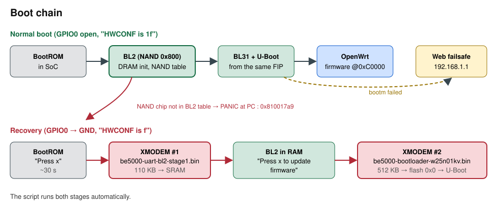
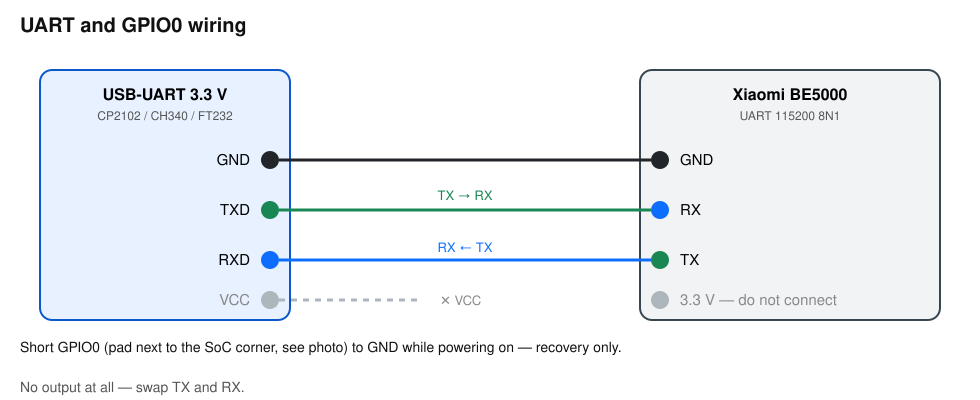
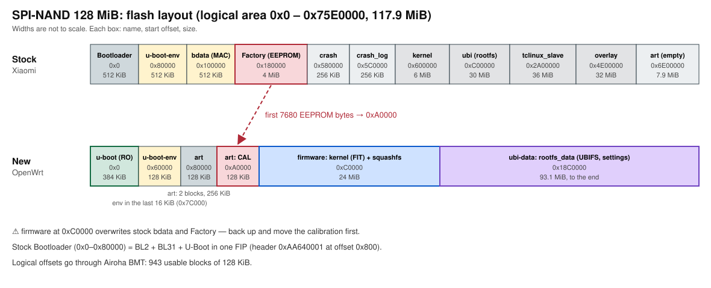

# OpenWrt на Xiaomi BE5000 (Airoha AN7563)

[English](README.md) · **Русский**

> [!IMPORTANT]
> **Коротко.** Репозиторий описывает, как поставить OpenWrt на Xiaomi BE5000, имея только root-доступ по SSH, и как поднять роутер по UART, если загрузчик сломался.
> - **Три шага:** одна команда на компьютере, один файл через браузер, настройка Wi-Fi. Установщик сначала проверяет чип флеша: загрузчик здесь знает 57 чипов NAND, включая **Winbond W25N01KV**, на котором загрузчики xinyooo и X-WRT падают (`PANIC at PC : 0x810017a9`).
> - **Скорость Wi-Fi:** 1757 Мбит/с скачивание и 1643 Мбит/с отдача через BE5000 (OpenSpeedTest, MacBook 2x2 на 160 МГц до ПК в проводной сети).
> - **Проверено на железе:** BE5000 (AN7563PT, W25N01KV, 512 МБ DDR3): установка из стоковой прошивки Xiaomi по SSH, восстановление по UART, установка через веб-failsafe, холодный старт, своя сборка OpenWrt с настройками в UBI, калибровка Wi-Fi из заводских данных Factory самого роутера.

## Содержание

1. [Что работает](#1-что-работает)
2. [Что нужно](#2-что-нужно)
3. [Установка](#3-установка) → подробно: [docs/ru/install-ssh.md](docs/ru/install-ssh.md)
4. [Если загрузчик сломался: UART](#4-если-загрузчик-сломался-uart) → подробно: [docs/ru/recovery-uart.md](docs/ru/recovery-uart.md)
5. [Файлы](#5-файлы)
6. [Как это устроено](#6-как-это-устроено) → подробно: [docs/en/technical.md](docs/en/technical.md) (англ.)
7. [Источники и благодарности](#7-источники-и-благодарности)
8. [Обратная связь](#8-обратная-связь)

## 1. Что работает

Всё ниже проверено на BE5000 с этой прошивкой.

| Что | Как работает |
|---|---|
| **Система** | OpenWrt SNAPSHOT `r36539+836`, ядро **Linux 6.18.55** ([подробности сборки](firmware/openwrt/README.md), англ.) |
| **Wi-Fi 5 ГГц** | 160 МГц, Wi-Fi 6/7. MacBook 2x2: скачивание **1757 Мбит/с**, отдача **1643 Мбит/с** ([замер](docs/en/technical.md#speed), англ.) |
| **Wi-Fi 2,4 ГГц** | работает, 20/40 МГц |
| **Аппаратное ускорение** | трафик Wi-Fi ↔ провод идёт через PPE и NPU, процессор на полной скорости загружен на ~10% |
| **Роуминг** | 802.11r: телефоны и ноутбуки бесшовно переходят между BE5000 и другой точкой OpenWrt с той же сетью |
| **Порты** | три по 1 Гбит/с и один 2,5 Гбит/с, все в одной сети |
| **Настройки** | сохраняются после перезагрузок и отключения питания, переносятся при обновлении прошивки |
| **Перезагрузка** | обычная и по питанию, без зависаний; при зависании роутер сам перезагружается через ~30 с (watchdog) |
| **Управление** | веб-интерфейс LuCI и SSH на `192.168.1.1`, обновления через `sysupgrade` |
| **MAC-адреса** | с наклейки роутера, из его заводской калибровки |


**Ограничение:** скачивание на одном быстром клиенте упирается примерно в 1,35–1,75 Гбит/с. Предел задаёт канал PCIe между процессором и радио (одна линия, 5 GT/s).

## 2. Что нужно

- **Роутер с root-доступом по SSH** на стоковой прошивке Xiaomi. Как получить root на стоке, здесь не описано: см. [тему на форуме OpenWrt](https://forum.openwrt.org/t/xiaomi-be5000-wifi7-router/199438) и [xmir-patcher](https://github.com/openwrt-xiaomi/xmir-patcher). Уже стоит OpenWrt xinyooo/iscle? Нужен только [`sysupgrade -n`](#с-openwrt-xinyooo-или-iscle).
- **Компьютер** с macOS или Linux (на Windows — WSL): `ssh`, `curl` и `git` (или скачайте репозиторий как ZIP через зелёную кнопку **Code**), и **сетевой кабель** до роутера. `python3` нужен только для восстановления по UART и скрипта проверки загрузчика.

## 3. Установка

> [!WARNING]
> Установка перезаписывает заводские разделы `bdata` и `Factory`. Вернуться на прошивку Xiaomi можно только из полного бэкапа, который установщик снимет на шаге 1.

**Шаг 1. Одна команда на компьютере.** Подключите компьютер кабелем к порту LAN роутера (не к порту 2.5G). Скачайте репозиторий и запустите установщик с адресом роутера:

```sh
git clone https://github.com/pabragin/xiaomi-be5000-openwrt && cd xiaomi-be5000-openwrt
sh install.sh root@192.168.31.1        # 192.168.31.1 — адрес стока Xiaomi; на OpenWrt обычно 192.168.1.1
```

Скрипт скачает образ OpenWrt из [последнего релиза](https://github.com/pabragin/xiaomi-be5000-openwrt/releases/latest) и сверит его с контрольными суммами релиза. Потом один раз спросит пароль роутера и:
1. проверит чип флеша и разделы (если загрузчик не поддерживает чип, остановится, ничего не записав);
2. сохранит полный бэкап флеша в папку `be5000-backup-<дата>` (её нужно сохранить: без неё прошивку Xiaomi не вернуть);
3. спросит `YES`, перенесёт калибровку Wi-Fi и запишет загрузчик;
4. перезагрузит роутер.

**Шаг 2. Прошивка через браузер.**
1. Задайте компьютеру адрес вручную: IP `192.168.1.10`, маска `255.255.255.0`. На macOS: «Настройки → Сеть → (адаптер) → Подробнее → TCP/IP → Вручную». В WSL адрес задаётся в Windows, а файл в браузере лежит в `\\wsl$\<дистрибутив>\home\…`.
2. Откройте `http://192.168.1.1`, выберите файл `firmware/openwrt/openwrt-airoha-an7563-xiaomi_be5000-squashfs-sysupgrade.bin`, скачанный на шаге 1 (установщик печатает полный путь), нажмите **Upload**, затем **Proceed**.
3. Подождите 5 минут и не выключайте питание. Роутер сам перезагрузится в OpenWrt.

**Шаг 3. Настройка.** Верните компьютеру автоматический адрес (DHCP), откройте `http://192.168.1.1` и задайте пароль. Затем в **Network → Wireless** укажите страну, имя и пароль сети и нажмите **Enable** у обоих радио (Wi-Fi по умолчанию выключен). Все четыре порта по умолчанию LAN: если этот роутер подключается к провайдеру, в **Network → Interfaces** сначала уберите порт провайдера (например 2.5G) из моста LAN (**Devices → br-lan → Bridge ports**), затем добавьте интерфейс `wan` с протоколом **DHCP client** на этом порту.

> [!CAUTION]
> Если во время записи загрузчика пропало питание или после шага 1 роутер не появляется в сети, поднять его можно только по UART (раздел 4).

**Назад на Xiaomi.** Только из бэкапа шага 1, и эта процедура здесь не проверялась. Заводские разделы не совпадают с разделами OpenWrt, поэтому их пишут по абсолютным смещениям из консоли U-Boot через UART (`python3 scripts/pc/be5000-uart-recover.py ПОРТ --console`, команды `mtd` описаны в [инструкции по UART](docs/ru/recovery-uart.md#калибровка-из-консоли-u-boot)): для каждого файла `mtdN-<имя>.bin` из бэкапа `tftpboot 0x84000000 mtdN-<имя>.bin`, `mtd erase spi-nand0 СМЕЩЕНИЕ РАЗМЕР`, `mtd write spi-nand0 0x84000000 СМЕЩЕНИЕ РАЗМЕР`, где смещение и размер берутся из `sysfs_mtd.txt` бэкапа; загрузчик (`mtd0`, смещение 0) последним. Загрузчик можно записать и скриптом восстановления: `python3 scripts/pc/be5000-uart-recover.py ПОРТ --image be5000-backup-<дата>/mtd0-<имя>.bin`.

Каждый шаг по отдельности, ручная проверка чипа и случай `READ-ONLY`: [docs/ru/install-ssh.md](docs/ru/install-ssh.md).

### С OpenWrt xinyooo или iscle

Ваш загрузчик уже грузит ваш чип флеша, а калибровка уже лежит в `0xA0000`, поэтому `install.sh` не нужен (и не смог бы записать загрузчик: на тех образах `u-boot` только для чтения). На компьютере:

```sh
curl -LO https://github.com/pabragin/xiaomi-be5000-openwrt/releases/latest/download/openwrt-airoha-an7563-xiaomi_be5000-squashfs-sysupgrade.bin
ssh root@192.168.1.1 'cat > /tmp/sysupgrade.bin' < openwrt-airoha-an7563-xiaomi_be5000-squashfs-sysupgrade.bin
ssh root@192.168.1.1 sysupgrade -n /tmp/sysupgrade.bin
```

После перезагрузки роутер на `192.168.1.1`, root без пароля, Wi-Fi выключен: дальше шаг 3. Этот путь здесь ещё не проверялся. Настройки не сохраняются: этот образ хранит их в UBI, а не в JFFS2, потому что на флеше W25N01KV JFFS2 портит записи и роутер после перезагрузки поднимается без сети ([issue #1](https://github.com/pabragin/xiaomi-be5000-openwrt/issues/1)).

## 4. Если загрузчик сломался: UART

Признаки: тишина в сети, в UART-логе `PANIC at PC : 0x810017a9` или любая остановка до U-Boot.



1. Подключите USB-UART: GND–GND, TX↔RX, **VCC не подключать**, 115200 8N1.
   
2. Запустите `python3 scripts/pc/be5000-uart-recover.py /dev/ttyUSB0` (на macOS порт называется `/dev/cu.usbserial-…`).
3. Замкните **GPIO0 на GND**, держите и включите питание. Где площадка — на [фото](docs/ru/recovery-uart.md#где-gpio0).
4. Скрипт сам пройдёт оба этапа XMODEM и запишет загрузчик. Затем разомкните GPIO0.

Подробно, с фото и таблицей ошибок: [docs/ru/recovery-uart.md](docs/ru/recovery-uart.md).

## 5. Файлы

| Файл | Что это | Куда |
|---|---|---|
| [`firmware/bootloader/be5000-bootloader-w25n01kv.bin`](firmware/bootloader/) | загрузчик 512 КБ: BL2 (57 чипов NAND) + BL31 + U-Boot | флеш `0x0` (SSH: `be5000-install.sh bootloader`; UART: XMODEM №2) |
| [`firmware/bootloader/be5000-uart-bl2-stage1.bin`](firmware/bootloader/) | тот же BL2 в мини-FIP | только UART, XMODEM №1 в BootROM |
| [`openwrt-…-squashfs-sysupgrade.bin`](https://github.com/pabragin/xiaomi-be5000-openwrt/releases/latest) | OpenWrt ([описание сборки](firmware/openwrt/README.md)): ядро FIT + squashfs. Лежит в релизе, `install.sh` скачивает его сам | раздел `firmware` `0xC0000` (веб-failsafe или `sysupgrade`) |
| [`openwrt-…-initramfs-kernel.bin`](https://github.com/pabragin/xiaomi-be5000-openwrt/releases/latest) | OpenWrt в RAM для проверки и восстановления. Лежит в релизе | TFTP → `bootm`, флеш не трогает |
| [`install.sh`](install.sh) | установка одной командой: проверка, бэкап, калибровка, загрузчик | запускается на компьютере |
| [`scripts/router/be5000-install.sh`](scripts/router/be5000-install.sh) | проверка, запись калибровки и загрузчика с проверкой чтением | запускается на роутере |
| [`scripts/pc/`](scripts/pc/) | бэкап, UART-восстановление, проверка загрузчика | запускается на ПК |

Контрольные суммы и происхождение бинарников: [firmware/bootloader/README.md](firmware/bootloader/README.md), [firmware/openwrt/README.md](firmware/openwrt/README.md).

## 6. Как это устроено

| Компонент | Что стоит на флеше |
|---|---|
| Загрузчик (0x0–0x80000) | BL2 с поддержкой W25N01KV + BL31 + U-Boot 2026.01 (автозагрузка, веб-failsafe на `192.168.1.1`) |
| Калибровка Wi-Fi | заводская EEPROM MT7992 перенесена в блок `0xA0000` (раздел `art`) |
| Прошивка | OpenWrt (своя сборка на основе [iscle](https://github.com/iscle/openwrt)) в разделе `firmware` с `0xC0000`, 24 МБ |
| Настройки | раздел `ubi` с `0x18C0000`, 40 МБ, том `rootfs_data` (UBIFS) |



- **Что внутри загрузчика.** BL2 со списком из 57 чипов NAND (включая W25N01KV), BL31 и U-Boot 2026.01 xinyooo с автозагрузкой и веб-failsafe.
- **Почему два файла для UART.** BootROM принимает по XMODEM не больше `0x1F800` байт и только FIP с одним BL2. Затем BL2 сам просит `Press x to update firmware` и принимает весь 512 КБ образ, который записывает во флеш.

Подробно, с логами и адресами: [docs/en/technical.md](docs/en/technical.md) (англ.).

## 7. Источники и благодарности

- [xinyooo](https://github.com/xinyooo/openwrt/releases): порт AN7563, U-Boot с веб-failsafe, [PR #23960](https://github.com/openwrt/openwrt/pull/23960), [тема на форуме](https://forum.openwrt.org/t/release-custom-openwrt-u-boot-for-xiaomi-be5000-an7563/250004).
- [100PoR-new](https://github.com/openwrt/openwrt/pull/23960#issuecomment-6173662443): BL2 с W25N01KV (собран через [make_airoha_atf](https://github.com/xinyooo/make_airoha_atf)) и фото GPIO0.
- [iscle](https://github.com/iscle/openwrt): порт OpenWrt для BE5000, разметка с калибровкой в `art`, DSA, PPE, Wi-Fi.
- [Ansuel/atf-airoha](https://github.com/Ansuel/atf-airoha): исходники BL2, по которым разобран формат XMODEM-восстановления.
- [Medvedolog, issue #17](https://github.com/Medvedolog/airoha-router-ursusflasher/issues/17): наблюдения BootROM AN7552.

**Лицензии.** Скрипты и документация: MIT ([LICENSE](LICENSE)). U-Boot и OpenWrt: GPL-2.0, исходники в [форке OpenWrt](https://github.com/pabragin/openwrt/tree/be5000-main). BL2 и BL31 внутри загрузчика — бинарники Airoha без опубликованной лицензии, взяты из сборки 100PoR-new. Фото: GPIO0 от 100PoR-new, контакты UART из темы на right.com.cn.

## 8. Обратная связь

Отчёты об успехах и проблемах — в [Issues](https://github.com/pabragin/xiaomi-be5000-openwrt/issues). Укажите чип NAND и вывод `be5000-install.sh check`.
