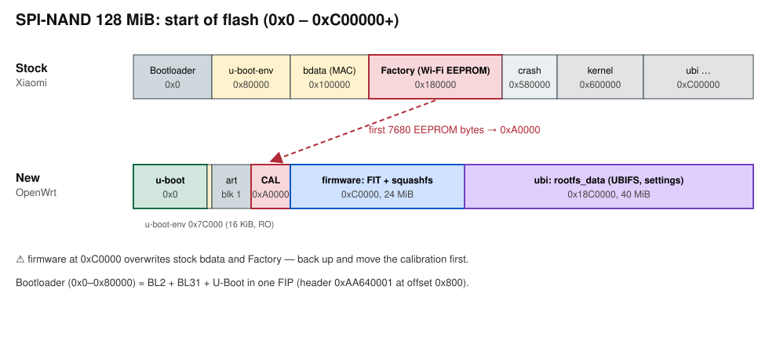

# How it works

[← README](../../README.md) · [Русский](../ru/technical.md)

> [!IMPORTANT]
> **TL;DR.** The AN7563 boots through the chain BootROM → BL2 → BL31 → U-Boot. BL2 reads NAND itself using a built-in chip table: no chip, `panic()`. For recovery, both BootROM and BL2 support XMODEM, but each accepts its own format.

## Contents

1. [Hardware](#hardware)
2. [Flash layout](#flash-layout)
3. [Bootloader](#bootloader)
4. [Why PANIC](#why-panic)
5. [XMODEM recovery](#xmodem-recovery)
6. [Wi-Fi calibration](#wi-fi-calibration)
7. [OpenWrt image](#openwrt-image)
8. [PCIe](#pcie)
9. [Supported NAND chips](#supported-nand-chips)

## Hardware

| Component | Value |
|---|---|
| SoC | Airoha AN7563PT (BL2 log shows `AN7552DRAMC V0.4`), 2× Cortex-A7 |
| DRAM | 512 MB DDR3 (Winbond W634GU6…), 1866 MT/s |
| NAND | 128 MB SPI-NAND, varies between batches: Winbond **W25N01KV**, ESMT and others |
| Wi-Fi | MediaTek MT7992 (2.4 + 5 GHz), EEPROM in flash |
| Ethernet | built-in MT7530 switch (3× 1 Gbit) + EN8811H (2.5 Gbit) |
| UART | 115200 8N1, 3.3 V |

## Flash layout



| Offset | Xiaomi stock firmware | After install | Size |
|---|---|---|---|
| `0x000000` | Bootloader | u-boot | `0x7C000` |
| `0x07C000` | ↑ | u-boot-env (RO) | `0x4000` |
| `0x080000` | u-boot-env | art: block 1 | `0x20000` |
| `0x0A0000` | ↑ (empty) | art: block 2 = **calibration** | `0x20000` |
| `0x0C0000` | ↑ | firmware: kernel (FIT) | `0x3C0000` |
| `0x100000` | bdata (`ethaddr=…`) | ↑ | |
| `0x180000` | **Factory** (EEPROM `92 79` + MAC) | firmware: rootfs | |
| `0x600000` | kernel (stock) | ↑ | |
| `0xC00000` | ubi (stock) | ↑ | |
| `0x40C0000` | ↑ | end of firmware | |

Logical addresses are mapped through Airoha BMT: `BMT v1 at block 1023`, `BBT v1 at block 943`, 943 usable blocks.

## Bootloader

The first `0x80000` bytes: 0x800 zero bytes, then a TF-A FIP (`0xAA640001`, serial `0x12345678`):

| Part | UUID (first bytes) | What it does |
|---|---|---|
| BL2 | `5ff9ec0b` | small decompressor + LZMA: DRAM, SPI-NAND table, FIP loading |
| BL31 | `47d4086d` | secure monitor |
| BL33 | `d6d0eea7` | U-Boot (LZMA) |

BootROM loads BL2 from NAND itself. Then BL2 reads the FIP from offset `0x800` with its own driver and checks the header at `FIP_BASE`.

## Why PANIC

BL2 sources: [Ansuel/atf-airoha](https://github.com/Ansuel/atf-airoha), `plat/ecnt/en7523/ecnt_bl2_setup.c`:

```c
if (flash_read(fip_offset, PLAT_ECNT_FIP_MAX_SIZE, (uint8_t *) PLAT_ECNT_FIP_BASE) == FLASH_READ_STATUS_CORRECT) { }
else { panic(); }
...
while (plat_check_header((uint8_t *) PLAT_ECNT_FIP_BASE) == 0) { panic(); }
```

If the NAND chip is not in the BL2 table, `flash_read` fails, and every cold boot ends with `PANIC at PC : 0x810017a9`.

| BL2 | Chips | W25N01KV |
|---|---|---|
| xinyooo v2026.05-r1…v2026.06-r1 (`8d363ec4…`), X-WRT 26.10 preloader | 56 | no |
| build r35200+4 from 2026-07-02, this repository | 57 | **yes** |

> [!NOTE]
> After a warm reboot from Linux, a "bad" BL2 sometimes gets to U-Boot. Test the bootloader only with a cold boot: power from the wall socket.

## XMODEM recovery

| Stage | Receiver | Prompt | Format | Limit |
|---|---|---|---|---|
| 1 | BootROM (GPIO0 = GND, `HWCONF is f`) | `Press x` | FIP with a single BL2 entry at offset `0x60` | ≤ `0x1F800` bytes, waits ~30 s |
| 2 | BL2 from stage 1 | `Press x to update firmware` | full 512 KB image: 0x800 zero bytes + FIP | length exactly `0x80000` → BL2 writes it to flash at 0 |

Both stages use XMODEM-CRC with 128-byte blocks.

| What was sent | Result |
|---|---|
| full 512 KB image to stage 1 | `CAN` at block 1009 (`0x1F800`) |
| bare BL2 to stage 1 | accepted, silence |
| FIP without the 0x800 zero bytes to stage 2 | `PANIC`: BL2 places the file at `FIP_BASE - 0x800`, so the header ends up in the wrong place |

## Wi-Fi calibration

- **On stock:** the MT7992 EEPROM is at the start of the Factory partition (`0x180000`), 7680 bytes (`0x1E00`), starts with `92 79`, then the base MAC. The rest of the partition is `FF`.
- **On the new flash layout:** OpenWrt reads the EEPROM from the second block of `art` (`0xA0000`) through NVMEM.
- **How it is moved:** `be5000-calibration.py` takes the first `0x1E00` bytes and pads them with `FF` to 128 KB.

Without calibration, `dmesg` shows `mt7996e … eeprom load fail, use default bin`: the driver uses the MediaTek default EEPROM. Wi-Fi works, but its MAC `00:0c:43:26:60:10` is the same on every unit, so on first boot each radio gets a random `macaddr_base` in `/etc/config/wireless`.

## OpenWrt image

`squashfs-sysupgrade.bin` is not a tar but a ready image of the `firmware` partition:

| Offset | What |
|---|---|
| `0x000000` | FIT (`d00dfeed`): kernel + DTB |
| `0x3C0000` | squashfs (`hsqs`) |
| after squashfs | `deadc0de`, then sysupgrade metadata |

U-Boot reads the first `fitsize = 0x500000` bytes of the partition and runs `bootm`. The web failsafe writes the uploaded file to the `firmware` partition as is.

Settings are not in `firmware` but in a separate `ubi` partition (`0x18C0000`, 40 MiB), volume `rootfs_data` (UBIFS). JFFS2 does not work on W25N01KV: it programs page 0 of a block twice (cleanmarker in OOB, then data), and the chip's on-die ECC corrupts such a page ([issue #1](https://github.com/pabragin/xiaomi-be5000-openwrt/issues/1)).

## PCIe

The MT7992 radio is attached over two PCIe links: `0000:01:00.0` (main) and `0001:01:00.0` (second interface). The AN7563 root ports have one lane each and up to 5 GT/s; the radio supports 8 GT/s.

- **Problem:** after power-up the links train at 2.5 GT/s and never move up. For downloads the radio reads every packet from the router's memory over PCIe, so at 2.5 GT/s x1 downloads were capped at about 1 Gbit/s.
- **Fix:** the kernel retrains both links to 5 GT/s right after link up. The Xiaomi stock kernel does the same (`mt7512_pcie_rc0_retrain`, `mt7512_pcie_rc1_retrain`).
- **Check:** `cat /sys/bus/pci/devices/0000:01:00.0/current_link_speed` → `5.0 GT/s PCIe`; `dmesg` shows `link retrained to 5.0 GT/s PCIe` for both ports.

| PCIe | Download (2x2 160 MHz client) |
|---|---|
| 2.5 GT/s x1 | ~1.05 Gbit/s |
| 5 GT/s x1 | ~1.45 Gbit/s (8 HTTP streams), 1757 Mbit/s in OpenSpeedTest |

## Supported NAND chips

BL2 in `be5000-bootloader-w25n01kv.bin` (57 chips):

```
ATO25D1GA BWET08U BWJX08U EM73C044SNB EM73C044SND EM73C044SNF EM73C044VCA EM73C044VCD
EM73D044SNA EM73D044SNC EM73D044SND EM73D044SNF EM73D044VCA EM73D044VCB EM73D044VCD
EM73D044VCG EM73D044VCH EM73E044SNA EM73E044VCA EM73E044VCB EM73F044SNA F50L1G F50L1G41LB
F50L2G41LB FM25G01B FM25G02 FM25G02B FM25S01 FS35ND01GD1F1 FS35ND02GD1F1 FS35ND02GS2F1
GD5F1GQ4UB GD5F2GQ4UB GD5F2GQ4UE9IS GD5F4GQ4UB HYF2GQ4UAACAE MT29F1G01 MT29F2G01 MT29F4G01
MXIC35LF1G MXIC35LF1G24AD MXIC35LF2G MXIC35LF2G14AC MXIC35LF2GE4AD PSU1GS20BN S35ML02G3
TC58CVG0S3H TC58CVG1S3H TC58CVG2S0H W25M02G W25N01G W25N01KV W25N02K W25N04K
XT26G01A XT26G02A XT26G02B
```

To check any other image: `python3 scripts/pc/be5000-check-bootloader.py file.bin --chip <your chip>`.
