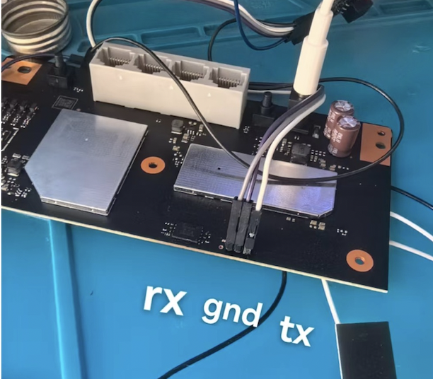
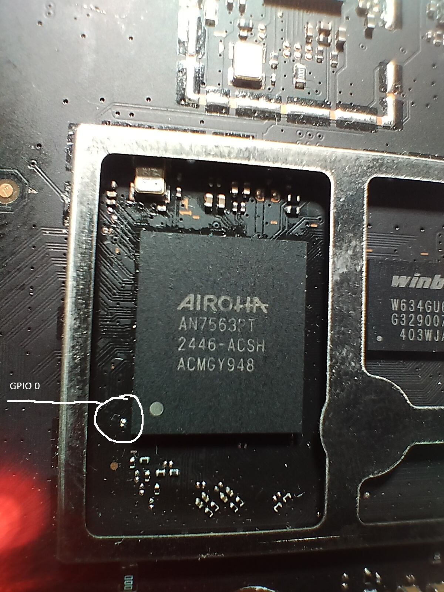

# Восстановление загрузчика по UART

[← README](../../README.ru.md) · [English](../en/recovery-uart.md)

> [!IMPORTANT]
> **Коротко.** Программатор не нужен. BootROM в SoC умеет принимать код по UART, если при включении замкнуть **GPIO0 на GND**. Скрипт `be5000-uart-recover.py` за ~2 минуты отправит BL2, потом загрузчик, и BL2 сам запишет его во флеш.

## Содержание

1. [Готово, когда](#готово-когда)
2. [Что нужно](#что-нужно)
3. [Подключение UART](#подключение-uart)
4. [Где GPIO0](#где-gpio0)
5. [Восстановление](#восстановление)
6. [После восстановления](#после-восстановления)
7. [Калибровка из консоли U-Boot](#калибровка-из-консоли-u-boot)
8. [Что видно в логе](#что-видно-в-логе)
9. [Проблемы](#проблемы)

## Готово, когда

- [ ] В логе есть `U-Boot 2026.01-OpenWrt-r34326`.
- [ ] После снятия перемычки GPIO0 и **холодного** включения в логе нет `PANIC`, U-Boot стартует сам.

## Что нужно

| Что | Комментарий |
|---|---|
| USB-UART 3.3 В | CP2102, CH340, FT232. **Не 5 В** |
| 3–4 провода, пинцет или проводок для GPIO0 | GPIO0 держать замкнутым всё время восстановления |
| ПК с macOS или Linux, `python3` | на Windows — WSL + `usbipd` или Linux live USB |
| Отвёртка | снять нижнюю крышку; полная разборка не нужна |

## Подключение UART


1. GND адаптера → GND роутера.
2. TX адаптера → RX роутера, RX адаптера → TX роутера.
3. **VCC не подключать.** Роутер питается от своего блока.
4. Параметры: 115200, 8N1, без управления потоком.

> [!TIP]
> Проверка связи: запустите `python3 scripts/pc/be5000-uart-recover.py <порт>` и включите роутер **без** GPIO0. Если в `be5000-uart.log` появился текст (`Secure key does not exist`, `AN7552DRAMC`), всё подключено правильно. Если лог пустой — поменяйте TX и RX местами.

Где контакты на плате: три штыря у края платы между радиаторами, слева направо (LAN-порты сзади) **RX, GND, TX** роутера. Значит, TX адаптера идёт на левый (RX), RX адаптера на правый (TX). Фото: [right.com.cn](https://www.right.com.cn).



## Где GPIO0

Площадка GPIO0 у левого нижнего угла SoC AN7563, внутри рамки экрана. Фото: [100PoR-new](https://github.com/openwrt/openwrt/pull/23960#issuecomment-6173662443).



Замыкать GPIO0 нужно на **GND**, например на рамку экрана рядом. Признак, что перемычка работает: в логе `HWCONF is f` вместо `HWCONF is 1f`.

## Восстановление


1. Выключите роутер из розетки.
2. Запустите скрипт, он будет ждать до 15 минут:
   ```sh
   python3 scripts/pc/be5000-uart-recover.py /dev/ttyUSB0        # Linux
   python3 scripts/pc/be5000-uart-recover.py /dev/cu.usbserial-0001  # macOS
   ```
3. Замкните GPIO0 на GND и **держите**.
4. Включите питание. Дальше скрипт всё делает сам:
   1. BootROM печатает `Press x`, скрипт отправляет `x` и `be5000-uart-bl2-stage1.bin` (~10 с).
   2. BL2 запускается, инициализирует память и печатает `Press x to update firmware`.
   3. Скрипт отправляет `be5000-bootloader-w25n01kv.bin` (~70 с). BL2 пишет его во флеш с адреса 0 и запускает U-Boot.
5. Когда скрипт напишет `Done`, отпустите GPIO0.

> [!WARNING]
> На шаге 4.3 не выключайте питание. Если всё же выключили, просто повторите с шага 1: BootROM в SoC стереть нельзя.

## После восстановления

U-Boot сразу пробует загрузить OpenWrt из раздела `firmware`:

| Что в `firmware` | Что будет | Что делать |
|---|---|---|
| OpenWrt (iscle/xinyooo) | загрузится как обычно | ничего |
| пусто или сток Xiaomi | поднимется веб-failsafe `http://192.168.1.1` | [шаг 5 установки](install-ssh.md#шаг-5-прошивка-через-веб-failsafe) |

Если на флеше ещё заводская разметка, перенесите калибровку **до** шага 5: прошивка пишется с `0xC0000` и затирает заводской раздел `Factory`. Проще всего загрузить initramfs OpenWrt из этого репозитория по TFTP (раздел ниже) и выполнить `be5000-install.sh calibration`: команда находит заводские данные `Factory` внутри `firmware` и пишет блок в `art`, который в этой сборке доступен на запись. Без initramfs — из консоли U-Boot (следующий раздел).

Чтобы попасть в консоль U-Boot, запустите скрипт с `--stop-autoboot`.

## Калибровка из консоли U-Boot

> [!WARNING]
> Составлено по команде `mtd` встроенного U-Boot, на железе пока не проверено. Все шаги, кроме `erase` и `write`, только читают.

В таблице разделов U-Boot `art` тоже только для чтения, поэтому команды обращаются ко всему чипу (`spi-nand0`) по абсолютному смещению. Первый блок 128 КБ заводского раздела `Factory` — это EEPROM MT7992 и дальше `FF`, то есть ровно калибровочный блок:

```text
U-Boot> mtd dump spi-nand0 0x180000 0x10      # must start with 92 79: the MT7992 EEPROM
U-Boot> mtd dump spi-nand0 0xa0000 0x10       # must be all ff: the block is empty
U-Boot> mtd read spi-nand0 0x84000000 0x180000 0x20000
U-Boot> mtd erase spi-nand0 0xa0000 0x20000
U-Boot> mtd write spi-nand0 0x84000000 0xa0000 0x20000
U-Boot> mtd dump spi-nand0 0xa0000 0x10       # 92 79 ... again
```

Если первый dump не начинается с `92 79`, остановитесь: `Factory` уже затёрт, калибровку нужно брать из бэкапа (`tftpboot 0x84000000 calibration.bin`, затем те же `erase` и `write`). Если второй dump не сплошные `ff`, тоже остановитесь и не стирайте неизвестные данные.

Затем перезагрузитесь (`reset`) и продолжайте с [шага 5 установки](install-ssh.md#шаг-5-прошивка-через-веб-failsafe).

OpenWrt в RAM — для бэкапа по SSH ([шаг 2 установки](install-ssh.md#шаг-2-бэкап)) или для тестов:

```text
U-Boot> setenv serverip 192.168.1.10
U-Boot> tftpboot 0x84000000 openwrt-airoha-an7563-xiaomi_be5000-initramfs-kernel.bin
U-Boot> bootm 0x84000000
```

Файл initramfs лежит в [`firmware/openwrt/`](../../firmware/openwrt/); положите его в корень TFTP-сервера на ПК (`192.168.1.10`).

## Что видно в логе

<details>
<summary>Сломанный BL2 (чипа NAND нет в таблице)</summary>

```
HWCONF is 1f
AN7552DRAMC V0.4
dram_type = PCDDR3, data_rate = 1866
DRAM FLOW DONE!!!
[MTK] Start initializing gpio setting from 0x7c004...
[MTK] No GPIO low config found in uboot env!
[MTK] No GPIO high config found in uboot env!
PANIC at PC : 0x810017a9
```
</details>

<details>
<summary>Удачное восстановление</summary>

```
HWCONF is f
Press x
CC                         <- BootROM принимает stage-1 по XMODEM
Secure key does not exist
AN7552DRAMC V0.4
DRAM FLOW DONE!!!
Press x to update firmware
CC                         <- BL2 принимает 512 КБ загрузчика
U-Boot 2026.01-OpenWrt-r34326-146052ab24 (May 12 2026 - 04:30:19 +0000)
CPU:   Airoha AN7563/AN7552
spi-nand: spi_nand nand@0: Winbond SPI NAND was found.
airoha-bmt: BBT v1 found at block 943 (0 bad blocks)
Hit any key to stop autoboot:  3
```
</details>

## Проблемы

| Что в логе | Причина | Решение |
|---|---|---|
| пусто | TX/RX перепутаны или нет общей земли | поменять TX и RX, проверить GND |
| нечитаемые символы | не та скорость | 115200 8N1 |
| `HWCONF is 1f`, нет `Press x` | GPIO0 не замкнут в момент включения | надёжнее замкнуть проводком и повторить |
| `Press x`, затем `^X^X^X` и обычная загрузка | BootROM не дождался файла (~30 с) | запускать скрипт **до** включения |
| `CAN` на блоке 1009 | в BootROM отправлен весь 512 КБ образ | на первом этапе нужен `be5000-uart-bl2-stage1.bin` |
| после stage-1 тишина | отправлен голый BL2 без FIP-заголовка | использовать файл из репозитория |
| `PANIC at PC : 0x810017a9` сразу после `Press x to update firmware` | отправлен FIP без 0x800 нулей в начале | нужен целый `be5000-bootloader-w25n01kv.bin`, 524288 байт |
| `PANIC` при обычной загрузке после восстановления | записан загрузчик, BL2 которого не знает ваш чип | `python3 scripts/pc/be5000-check-bootloader.py файл.bin --chip <чип>` |
